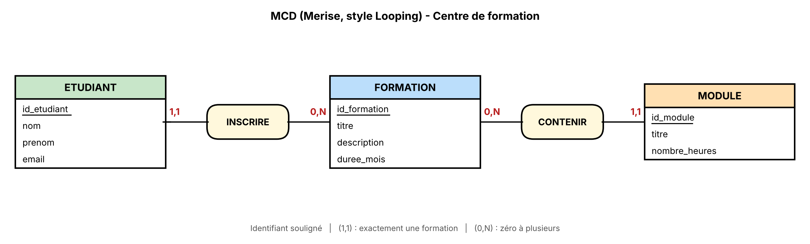
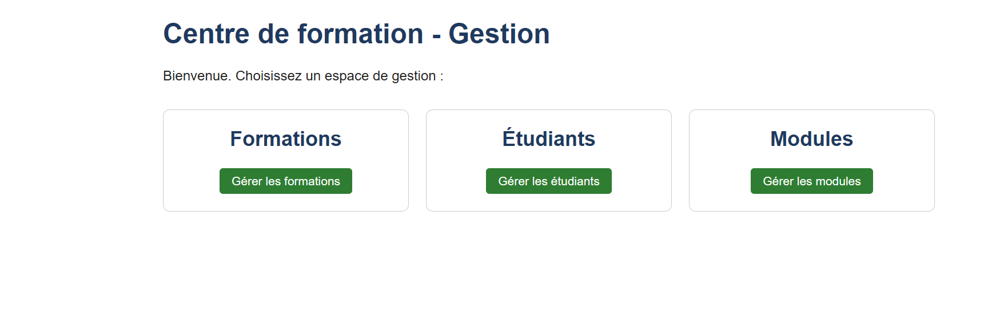
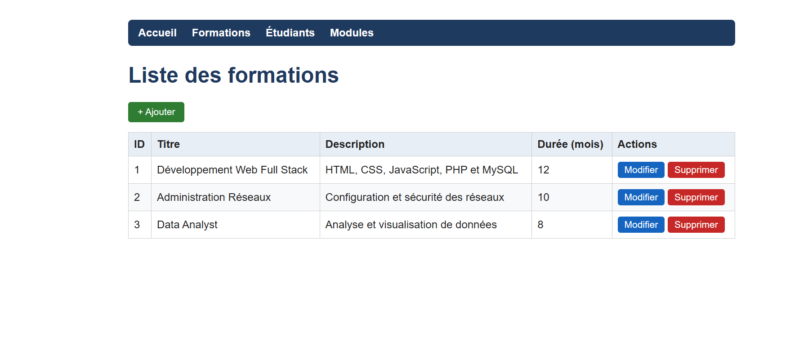
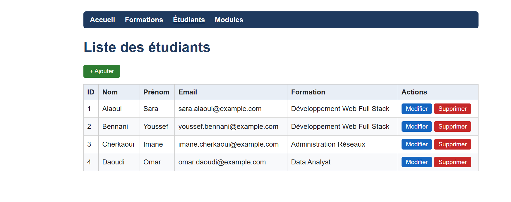
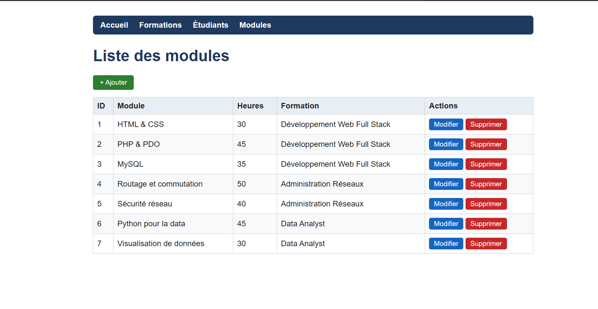

# TP7 - Conception et CRUD multi-entités

Nom : SABRI SALAH EDDINE
Filière : LST DI
N° étudiant : 2310961

---

## Présentation

Dans ce TP j'ai fait une petite application web pour un centre de formation. Elle permet de gérer les formations, les étudiants et les modules. J'ai utilisé PHP avec PDO, une base MySQL et XAMPP.

Les règles à respecter étaient les suivantes :

- le centre propose plusieurs formations
- un étudiant est inscrit dans une seule formation
- une formation peut avoir plusieurs étudiants
- une formation contient plusieurs modules
- un module appartient à une seule formation

## Ma conception

J'ai commencé par la conception avant d'écrire du code. J'ai trouvé trois entités : formation, étudiant et module.

| Table | Clé primaire | Autres attributs | Clé étrangère |
|---|---|---|---|
| formation | id_formation | titre, description, duree_mois | aucune |
| etudiant | id_etudiant | nom, prenom, email | id_formation |
| module | id_module | titre, nombre_heures | id_formation |

Les deux relations sont de type un à plusieurs. Une formation peut avoir plusieurs étudiants et plusieurs modules, donc la clé étrangère id_formation se met dans les tables etudiant et module (du côté "plusieurs").

Voici le MCD que j'ai fait avec Looping :



Dans le MCD on lit : un étudiant est inscrit dans une seule formation (1,1) et une formation peut avoir de zéro à plusieurs étudiants (0,N). C'est pareil pour les modules.

## La base de données

La base s'appelle tp7_crud. Le script SQL est dans le fichier `database/tp7_crud.sql`. Il crée les 3 tables avec les clés primaires auto-incrémentées et les clés étrangères, puis il ajoute quelques données pour tester.

Une remarque : j'ai mis `ON DELETE RESTRICT` sur les clés étrangères. Ça veut dire qu'on ne peut pas supprimer une formation qui a encore des étudiants ou des modules. Dans ce cas l'application affiche un message au lieu de planter.

## Organisation du projet

```
tp7-crud/
  index.php
  style.css
  database/
    connexion.php
    tp7_crud.sql
  formations/
    index.php  create.php  edit.php  delete.php
  etudiants/
    index.php  create.php  edit.php  delete.php
  modules/
    index.php  create.php  edit.php  delete.php
  docs/
```

Il y a un dossier par entité, avec les 4 pages du CRUD. La connexion à la base est dans un seul fichier, `database/connexion.php`, et je l'inclus partout avec `require_once`.

## Comment ça marche

- Lire : chaque page index.php fait un SELECT avec PDO, récupère le résultat avec fetchAll(PDO::FETCH_ASSOC) et l'affiche dans un tableau HTML, avec les liens Modifier et Supprimer.
- Ajouter : create.php contient un formulaire en POST. Les valeurs sont récupérées avec $_POST, puis insérées avec une requête préparée (prepare puis execute). Ensuite on revient à la liste.
- Modifier : edit.php récupère l'id dans l'URL, charge les données et remplit le formulaire. Ensuite il fait un UPDATE avec un WHERE sur l'id.
- Supprimer : delete.php fait un DELETE avec un WHERE sur l'id, puis revient à la liste.

Pour les relations, les listes des étudiants et des modules utilisent un INNER JOIN avec la table formation. Comme ça on voit le titre de la formation et pas juste un numéro. Dans les formulaires d'ajout et de modification, la formation se choisit dans une liste déroulante remplie depuis la base.

J'ai aussi utilisé des requêtes préparées partout et htmlspecialchars pour l'affichage, pour éviter les injections SQL et les failles XSS.

## Captures d'écran

La page d'accueil, avec un lien vers chacun des trois espaces :



La liste des formations :



La liste des étudiants. On voit le titre de la formation à la place de son identifiant :



La liste des modules, avec la formation de chaque module :



## Installation

1. Démarrer Apache et MySQL dans XAMPP.
2. Copier le dossier du projet dans `C:\xampp\htdocs\` avec le nom `tp7-crud`.
3. Ouvrir phpMyAdmin (http://localhost/phpmyadmin), aller dans l'onglet Importer et choisir le fichier `database/tp7_crud.sql`.
4. Ouvrir http://localhost/tp7-crud/ dans le navigateur.

Si la connexion ne marche pas, vérifier dans `database/connexion.php` que l'utilisateur est root avec un mot de passe vide (c'est la config par défaut de XAMPP).
